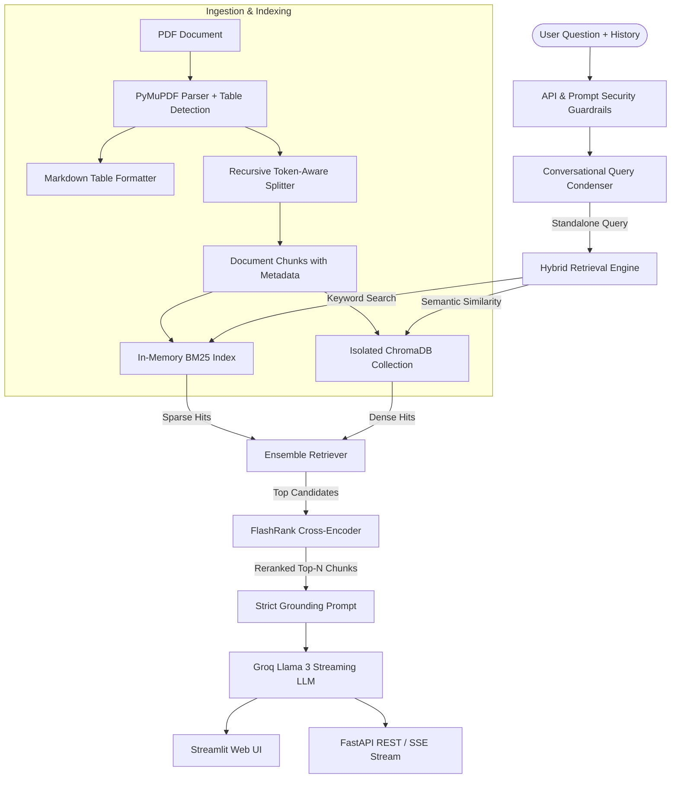

# Advanced Production Hybrid RAG Engine

[](https://github.com/ShashankS1011/advanced-hybrid-rag/actions/workflows/ci.yml)
[](https://shashanks1011-advanced-hybrid-rag-app-sofcpx.streamlit.app/)
[](https://github.com/ShashankS1011/advanced-hybrid-rag/actions/workflows/codeql.yml)
[](https://github.com/ShashankS1011/advanced-hybrid-rag/actions/workflows/lint.yml)
[](https://github.com/ShashankS1011/advanced-hybrid-rag/actions/workflows/docker.yml)
[](https://github.com/ShashankS1011/advanced-hybrid-rag/actions/workflows/security-audit.yml)
[](https://www.python.org/downloads/)
[](SECURITY.md)
[](https://opensource.org/licenses/MIT)

An enterprise-grade, retrieval-augmented generation (RAG) system engineered for high-precision, explainable document question answering over complex PDFs (financial reports, legal filings, technical whitepapers, contracts).

The engine integrates **table-aware document ingestion**, **isolated hybrid retrieval (BM25 + Chroma Vector Search)**, **FlashRank cross-encoder reranking**, **conversational query condensation**, **multi-layered API security guardrails**, and **in-text citation grounding** powered by **Groq Llama 3**. It offers both an interactive **Streamlit UI** and a production-ready **FastAPI REST & Server-Sent Events (SSE) streaming API**.

---

## Instant Live Web App

Access and test the full application immediately in your web browser without downloading or installing anything:

**[Launch Streamlit Live Web App](https://shashanks1011-advanced-hybrid-rag-app-sofcpx.streamlit.app/)**

> **Quick Start in the Web App:**
> 1. The demo is preloaded with a sample financial report (`financial_report.pdf`). You can start querying immediately or upload your own PDF in the sidebar.
> 2. The system operates using the secured host environment API key with multi-layered guardrails (adversarial prompt filtering, daily quota protection, and cooldown rate limiting).
> 3. To deploy your own private copy in 1 click:
>
> [](https://share.streamlit.io/deploy?repository=ShashankS1011/advanced-hybrid-rag&branch=main&mainModule=app.py)

---

## Architecture Overview



---

## Key Features

- **Multi-Format Ingestion:** Ingests and parses complex documents across formats: native and layout-rich PDFs with PyMuPDF table detection, plain text (`.txt`), Markdown (`.md`), JSON, and structured spreadsheets (`.csv`, `.tsv`) converted into Markdown tables.
- **Collection Isolation:** Dynamically namespaces vector database collections using document content hashes (`SHA-256`), eliminating cross-document contamination during hybrid search.
- **Query-Adaptive Hybrid Retrieval (Dynamic Alpha):** Dynamically adjusts BM25 sparse and Chroma dense weights per query (e.g. tilting toward BM25 for numeric/financial metrics like "Q4 2025" or "$3.1M", and toward dense embeddings for conceptual summaries).
- **Compound Query Decomposition:** Automatically breaks down complex multi-part questions into distinct sub-queries, retrieves candidates for each facet, and merges deduplicated evidence.
- **Semantic Query Caching:** Features an in-memory query response cache to deliver sub-millisecond answers for repeated questions, eliminating redundant Groq API usage and saving token budget.
- **Score-Filtered BM25:** Filters zero-score keyword matches to prevent non-matching documents from degrading hybrid search precision.
- **Cross-Encoder Reranking:** Reorders retrieved candidate chunks using `FlashRank` (`ms-marco-TinyBERT-L-2-v2`) for superior semantic relevance before LLM context injection.
- **Conversational Memory:** Uses chat history to reformulate ambiguous follow-up questions into self-contained search queries before retrieval.
- **Multi-Layered API Security & Guardrails:**
  - **Adversarial Injection Filtering:** Heuristic regex inspection blocks prompt injections, jailbreaks (`DAN mode`), and system prompt leakage attempts before consuming LLM tokens.
  - **Payload Bounds Enforcement:** Strict validation rejects empty, sub-minimum, or oversized queries (>500 characters).
  - **Duplicate Request Debounce:** Prevents rapid re-submission spamming.
  - **Rate Limiting & Cooldown:** Enforces minimum request intervals (2.5s) per session.
  - **Cost & Quota Caps:** Caps per-session queries (25 max) and enforces daily global budget ceilings (150 max).
  - **Credential Leakage Prevention:** Intercepts and transforms `401` and `429` error payloads while redacting API keys (`gsk_...`), bearer tokens, and internal paths from all user-facing error messages.
- **Strict In-Text Citations & Audit Export:** Enforces bracketed source references (e.g. `[Page 2]`) directly after every factual statement, with an interactive citation inspector and 1-click Markdown audit report export.
- **Dual Interfaces:**
  - **Streamlit Web UI:** Chat interface with dynamic parameter sliders, chunk inspection, and history management.
  - **FastAPI REST & Streaming Service:** Fully decoupled backend providing `/upload`, `/query`, and `/stream` (SSE) endpoints.
- **Automated RAG Evaluation:** Built-in benchmarking suite (`src/evaluate.py`) for citation accuracy, lexical overlap, and retrieval hit-rate metrics.
- **Dockerized Deployment:** Ready-to-deploy multi-stage `Dockerfile` and `docker-compose.yml`.

---

## Repository Structure

```text
.
├── src/
│   ├── __init__.py
│   ├── config.py          # Pydantic/dataclass runtime configuration & validation
│   ├── ingest.py          # Multi-format parsing (PDF, TXT, MD, CSV) & table extraction
│   ├── retriever.py       # Hybrid BM25 + Chroma retriever with adaptive weighting & FlashRank
│   ├── pipeline.py        # Conversational RAG pipeline, decomposition, caching & streaming
│   ├── security.py        # Prompt injection filter, rate limiting & error sanitization
│   ├── evaluate.py        # Automated RAG evaluation & benchmarking suite
│   └── api.py             # FastAPI REST & SSE streaming server
├── tests/
│   ├── test_core.py       # Unit tests for settings, ingestion, and retrievers
│   ├── test_pipeline.py   # Tests for pipeline orchestration, memory, and evaluation
│   ├── test_security.py   # Tests for prompt injection defense & sanitization
│   ├── test_improvements.py # Tests for multi-format, caching, decomposition & adaptive weighting
│   └── test_api.py        # Integration tests for FastAPI endpoints
├── data/                  # PDF storage directory
├── app.py                 # Interactive Streamlit web application
├── .streamlit/
│   └── config.toml        # Production UI theme & server configuration
├── Dockerfile             # Multi-stage production container build
├── docker-compose.yml     # Multi-container orchestration (UI + API)
├── pyproject.toml         # Pytest & package build configuration
├── requirements.txt       # Production dependencies
├── requirements-eval.txt  # Optional evaluation & benchmarking dependencies
├── .env.example           # Environment configuration template
└── README.md              # Project documentation
```
├── Dockerfile             # Multi-stage production container build
├── docker-compose.yml     # Multi-container orchestration (UI + API)
├── pyproject.toml         # Pytest & package build configuration
├── requirements.txt       # Production dependencies
├── requirements-eval.txt  # Optional evaluation & benchmarking dependencies
├── .env.example           # Environment configuration template
└── README.md              # Project documentation
```

---

## Getting Started

### Prerequisites

- Python 3.11+
- A [Groq API Key](https://console.groq.com)
- Git & Docker (optional)

### 1. Clone the Repository

```bash
git clone https://github.com/ShashankS1011/advanced-hybrid-rag.git
cd advanced-hybrid-rag
```

### 2. Set Up Virtual Environment

**Linux / macOS:**
```bash
python3 -m venv venv
source venv/bin/activate
```

**Windows (PowerShell):**
```powershell
python -m venv venv
.\venv\Scripts\Activate.ps1
```

### 3. Install Dependencies

```bash
pip install --upgrade pip
pip install -r requirements.txt
```

### 4. Configure Environment Variables

Copy the `.env.example` file to `.env`:

```bash
cp .env.example .env
```

Set your credentials and parameters in `.env`:

```env
GROQ_API_KEY=gsk_your_groq_api_key_here
GROQ_MODEL=llama-3.1-8b-instant
CHROMA_DB_DIR=./chroma_db
CHROMA_COLLECTION_NAME=advanced_hybrid_rag
EMBEDDING_MODEL=sentence-transformers/all-MiniLM-L6-v2
DEVICE=cpu

# Retrieval & Reranker Tuning
CHUNK_SIZE=1000
CHUNK_OVERLAP=200
DENSE_K=12
SPARSE_K=12
DENSE_WEIGHT=0.5
SPARSE_WEIGHT=0.5
RERANK_TOP_N=4
TEMPERATURE=0.1
SCORE_THRESHOLD=0.0
MAX_OUTPUT_TOKENS=1024

# Security Guardrails & Rate Limits
MAX_QUERY_LENGTH=500
MAX_SESSION_QUERIES=25
RATE_LIMIT_SECONDS=2.5
DAILY_GLOBAL_QUERY_LIMIT=150
```

---

## Running the Application

### Option A: Streamlit Cloud (Zero Setup)

Launch and interact with the system directly from your web browser without downloading or installing any dependencies:
- **Direct Live App:** [shashanks1011-advanced-hybrid-rag-app-sofcpx.streamlit.app](https://shashanks1011-advanced-hybrid-rag-app-sofcpx.streamlit.app/)
- **1-Click Deploy:** Click below to deploy your own instance on Streamlit Community Cloud:

  [](https://share.streamlit.io/deploy?repository=ShashankS1011/advanced-hybrid-rag&branch=main&mainModule=app.py)

#### Configuring Your Key on Streamlit Cloud (1-Time Setup):
To allow your deployed Streamlit Cloud application to query the LLM automatically:
1. Open your [Streamlit Cloud Dashboard](https://share.streamlit.io/).
2. Click the three dots (`...`) next to your deployed application and select **Settings**.
3. Navigate to the **Secrets** tab in the left menu.
4. Add your Groq API key:
   ```toml
   GROQ_API_KEY = "gsk_your_groq_api_key_here"
   ```
5. Click **Save**. The app will immediately bind the secret and activate querying.

### Option B: Local Streamlit Web UI

```bash
streamlit run app.py
```
Access the application at `http://localhost:8501`.

1. Upload a PDF in the sidebar (or use the preloaded `data/financial_report.pdf`).
2. Adjust retrieval depth and temperature sliders in real time.
3. Chat with the document and inspect reranked candidate chunks with cross-encoder relevance scores.

### Option C: FastAPI Backend

Start the API server with Uvicorn:

```bash
uvicorn src.api:app --host 0.0.0.0 --port 8000 --reload
```
Interactive OpenAPI documentation will be available at `http://localhost:8000/docs`.

#### API Usage Examples:

**1. Health Check:**
```bash
curl http://localhost:8000/health
```

**2. Upload a Document:**
```bash
curl -X POST "http://localhost:8000/upload" \
  -F "file=@data/financial_report.pdf"
```

**3. Query Document:**
```bash
curl -X POST "http://localhost:8000/query" \
  -H "Content-Type: application/json" \
  -d '{
    "question": "What was the total revenue in Q4 2025?",
    "document_path": "data/financial_report.pdf",
    "chat_history": []
  }'
```

**4. Stream Responses (Server-Sent Events):**
```bash
curl -N -X POST "http://localhost:8000/stream" \
  -H "Content-Type: application/json" \
  -d '{
    "question": "Summarize the financial highlights.",
    "document_path": "data/financial_report.pdf",
    "chat_history": []
  }'
```

---

## Running with Docker Compose

Spin up both the Streamlit UI and the FastAPI backend in isolated containers:

```bash
docker compose up --build
```

- **Streamlit Web UI:** `http://localhost:8501`
- **FastAPI Documentation:** `http://localhost:8000/docs`

---

## Automated Evaluation & Benchmarking

The project includes an evaluation framework in `src/evaluate.py` to benchmark groundedness, citation accuracy, and retrieval hit-rates:

```bash
python -m src.evaluate --pdf data/financial_report.pdf --output evaluation_report.json
```

Sample output:
```text
--- Evaluation Results ---
Total Questions Evaluated: 3
Citation Accuracy:        100.00%
Retrieval Hit Rate:       100.00%
Lexical Overlap Score:    78.40%
```

---

## Running Automated Tests

Run the full automated test suite (unit tests, integration tests, and security tests):

```bash
python -m pytest
```

Configuration and test path exclusions are managed via [`pyproject.toml`](file:///d:/Documents/advanced-hybrid-rag/pyproject.toml).

---

## Security

Please report vulnerabilities responsibly. See [`SECURITY.md`](SECURITY.md) for vulnerability disclosure procedures, supported versions, and response timelines.

---

## License

This project is licensed under the MIT License. See [LICENSE](LICENSE) for details.
